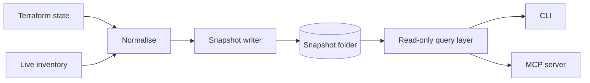

# Architecture

This is a short summary of how infra-ontology is meant to work. The code isn't written yet, so treat it as the plan, not a description of what exists. The details will move into their own pages as the parts land.

## The idea

One command reads what you already have (Terraform state from any backend, plus an inventory of the live cloud) and writes a local **snapshot**. A read-only query layer answers questions over the snapshot, and every answer cites the query, the snapshot and the age of its data. A stdio MCP server gives coding agents the same answers.

## The snapshot

A snapshot is one immutable folder:

- `manifest.json`: what is in it, with hashes, the parent snapshot, what was redacted and what was covered.
- `nodes.parquet`: one row per real thing (a resource, a module call, a state root, an account), with its kind, type, identifier, name, Terraform address and whether Terraform manages it.
- `edges.parquet`: typed links between nodes, each with a confidence (`observed`, `computed` or `inferred`) and a short basis.
- `sources.parquet`: where each row came from, and when.

No attribute values are stored. The snapshot's identifier is a hash of its manifest, which names the hash of every table, so a change to any byte changes the identifier. Parquet is an open format: anyone can query a snapshot with their own DuckDB. The JSON Schemas for the documents are published under `schemas/` (Apache-2.0).

## Ingest

- **State.** Read from S3, Google Cloud Storage, Azure Blob Storage, HCP Terraform or a local path. Only identifiers, addresses and dependencies are kept; the parser discards everything else before returning.
- **Live inventory.** Read from an export of a live cloud scan. A resource found in both state and inventory becomes one node; one found only in the inventory is marked unmanaged.
- **Normalise.** One node per real thing, with stable identifiers, de-duplicated edges and secret-looking tags dropped.

A source that fails does not silently shrink the estate: the snapshot is marked partial, and the answer says what is missing.

## Query

DuckDB, embedded, over views on the Parquet files. The dialect is restricted to read-only `SELECT`, with row caps, and checked in layers. The query layer also provides `diff` between two snapshots and `verify`, which checks a snapshot or an answer against its hashes, offline.

## MCP tools

A stdio server opens one snapshot and never writes, never connects to a cloud and takes no credentials. Four tools, all marked read-only: `inventory`, `blast_radius`, `query` and `snapshot_info`. A policy file can limit accounts, types and row counts.

## Red lines

No secret values, read-only, the user's own credentials, no writes to the cloud, no telemetry. See [AGENTS.md](../AGENTS.md).
