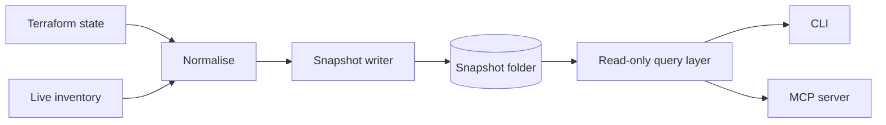

# Architecture

This is a short summary of how infra-ontology is meant to work. The snapshot (its format, writer, verify and diff) and the query layer are written; the MCP server is written too; ingest is still the plan, and says so. The details will move into their own pages as the parts land.

## The idea

One command reads what you already have (Terraform state from any backend, plus an inventory of the live cloud) and writes a local **snapshot**. A read-only query layer answers questions over the snapshot, and every answer cites the query, the snapshot and the age of its data. A stdio MCP server gives coding agents the same answers.

## The snapshot

This part is written (`internal/snapshot`). A snapshot is one immutable folder, named by its creation time and the start of its id (`20261125T101500Z-56eda5cee850`):

- `manifest.json`: the format (`infra-ontology/snapshot/v1`) and its minor version, the snapshot id, the parent snapshot's id, a label, the creation time, the tool, the status (`ok`, or `partial` if any source did not read in full), the name, SHA-256 and row count of each table, a summary of the sources, the redaction mode, what was covered and what could not be read, and a text of limits.
- `nodes.parquet`: one row per real thing (a resource, a module call, a state root, an account, or a placeholder for something referenced but not read), with its kind, scope, type, identifiers, name, Terraform address, whether Terraform manages it, environment, tags and confidence.
- `edges.parquet`: typed links between nodes (`depends_on`, `contained_in`, `defined_in`, `reads_state_of`), each with a confidence (`observed`, `computed` or `inferred`) and a short basis. An edge reads from refers to, or depends on, to.
- `sources.parquet`: where each row came from, and when.

No attribute values are stored. Tags are the one value kept, after the secret detectors. The JSON Schemas of the five documents (`snapshot`, `node`, `edge`, `source`, `answer`) are published under `schemas/` (Apache-2.0), and the tests validate the written manifest and every row against them.

**Content-addressed.** The snapshot id is the SHA-256 of the manifest with its `snapshot_id` member removed, written in canonical form (member names sorted, no white space). The manifest holds the SHA-256 of every table file, so a change to any byte of any file changes the id. `created_at` is part of the hash and is passed to the writer instead of read from the clock.

**Stable bytes.** The same rows give the same files, whatever order they arrive in. Rows are sorted (nodes by `node_id`, edges by `from_id`, `to_id` and `kind`, sources by `source_id`), times are put in UTC, sets in the manifest are sorted, and the Parquet writer's settings are fixed: one row group, no compression, plain data pages, no timestamp or file name in the metadata. Every column is a required string except a source's `serial`, and the tags are a list of key and value pairs sorted by key (a Parquet map would be written in Go's random map order). The Parquet is written with [parquet-go](https://github.com/parquet-go/parquet-go) (Apache-2.0, pure Go, no cgo), pinned in `go.mod`. A golden snapshot of a small estate (two environments, modules and a `reads_state_of` edge) pins the bytes; a change of the library version that alters one byte shows there and is reviewed with `go test ./internal/snapshot -update`.

**Verify.** `infra-ontology snapshot verify <dir>` works offline. It checks that the manifest's format is one it reads, that the id is the hash of the manifest, that every table is there with the hash, row count and row schema the manifest states, that no other table is there, and that the rows are consistent (unique ids, every edge joins two nodes, every row cites a source). It exits with 4 if any check fails and lists every problem. If the snapshot has a `manifest.sig.json` it reads it too, and checks it when given a key or an identity: see [signing](signing.md). The signature file is no part of the snapshot: it is not in the table list or the snapshot id.

**Diff.** `infra-ontology diff <a> [<b>]` loads two snapshots (verifying them first) and joins their nodes on `node_id` and their edges on `(from_id, to_id, kind)`. It reports what was added, removed and changed going from `a` to `b`. A change names the fields that differ, never their values, and leaves out the source, which changes whenever a state is read again. With one folder it compares that snapshot with its parent, found beside it by `parent_id`. Both commands print text, or JSON with `--json`.

**Export.** `infra-ontology export graph <dir>` verifies a snapshot and writes the part of it that graph/v1 can hold, for Terragram to draw. It lives in `internal/export`, which imports `internal/snapshot` and not the query engine. See [export.md](export.md).

**Build.** `infra-ontology snapshot build --state LOCATION` (repeatable) reads Terraform state with infraharvest's `pkg/tfstate` and writes a snapshot; see [state.md](state.md). `--from-json FILE` writes one from a JSON file of rows, a path for tests and development. `--inventory FILE` (repeatable) adds the live inventory from infraharvest's exports; see [inventory.md](inventory.md).

Parquet is an open format: anyone can query a snapshot with their own DuckDB.

## Ingest

- **State.** Read from S3, Google Cloud Storage, Azure Blob Storage, HCP Terraform or a local path (`internal/ingest`, on infraharvest's `pkg/tfstate`; [state.md](state.md)). Only identifiers, addresses, dependencies and the places `terraform_remote_state` reads from are kept; the parser discards everything else before returning. Each cloud's store is behind a build tag, so the default build links no cloud SDK.
- **Live inventory.** Read from infraharvest's `inventory/v1` and `ocsf-inventory/v1` exports, as files (`internal/ingest`; [inventory.md](inventory.md)). A resource found in both state and inventory becomes one node, `managed`; one found only in the inventory has the status the inventory gives it, `unmanaged` unless it knows who manages it. A part of another resource by the catalogue, or an Azure resource inside the one its ID names, gets a `contained_in` edge. Tags go through the secret detectors.
- **Normalise.** One node per real thing, with stable identifiers, de-duplicated edges and secret-looking tags dropped.

A source that fails does not silently shrink the estate: the snapshot is marked partial, and the answer says what is missing.

## Query

This part is written (`internal/query`, with the stored queries in `queries/`); see [query.md](query.md) for the dialect, the caps and the citation in full.

DuckDB, embedded, behind a small interface (`Engine` opens a `Session`; `Session.Query` checks, caps and runs one query). The snapshot's Parquet files are read into tables; then file access is turned off with no allowed paths and the configuration is locked, so a session cannot read or write a file, load an extension or change a setting. A long-lived session attaches its tables read-only. A query is never run as written: DuckDB parses it to a JSON tree, a pure-Go checker allows one `SELECT` or `WITH ... SELECT` over `nodes`, `edges`, `sources`, `snapshot` and the `blast` and `cone` macros and nothing else (an allow-list of node kinds, expression classes, functions and tables), and DuckDB writes the checked tree back as the canonical SQL that runs and that the answer cites. The result is capped by rows (`LIMIT cap + 1`, so truncation is known without a second query), columns, bytes and time.

Every answer carries a citation: the canonical query and its hash, the stored query and parameters if any, the snapshot id, the engine and dialect, the caps and any truncation, a hash of the result and a `limits` block taken from the manifest. `verify --answer` re-runs a cited answer against its snapshot and compares.

**The engine is replaceable and optional.** `snapshot`, `verify` and `diff` are pure Go and never import the query package (CI checks `go list -deps`). The DuckDB engine is `duckdb.go`, compiled unless the build says `-tags noduckdb`, which swaps in an engine that reports "built without the query engine". DuckDB needs cgo and links `libstdc++` at run time.

## MCP tools

`serve-mcp` is a stdio server. It verifies a snapshot, opens one locked session over it (tables attached read-only) and never writes, never connects to a cloud and takes no credentials. Four tools, all marked read-only: `inventory`, `blast_radius`, `query` and `snapshot_info`. `--tools` turns on a subset, and an append-only audit log records each call as hashes and counts, never rows. See [mcp.md](mcp.md) and [SKILL.md](../SKILL.md).

## Red lines

No secret values, read-only, the user's own credentials, no writes to the cloud, no telemetry. See [AGENTS.md](../AGENTS.md).
