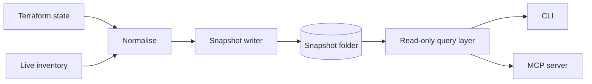

# Architecture

This is a short summary of how infra-ontology is meant to work. The snapshot (its format, writer, verify and diff) is written; ingest, the query layer and the MCP server are still the plan, and each says so. The details will move into their own pages as the parts land.

## The idea

One command reads what you already have (Terraform state from any backend, plus an inventory of the live cloud) and writes a local **snapshot**. A read-only query layer answers questions over the snapshot, and every answer cites the query, the snapshot and the age of its data. A stdio MCP server gives coding agents the same answers.

## The snapshot

This part is written (`internal/snapshot`). A snapshot is one immutable folder, named by its creation time and the start of its id (`20261125T101500Z-56eda5cee850`):

- `manifest.json`: the format (`infra-ontology/snapshot/v1`) and its minor version, the snapshot id, the parent snapshot's id, a label, the creation time, the tool, the status (`ok`, or `partial` if any source did not read in full), the name, SHA-256 and row count of each table, a summary of the sources, the redaction mode, what was covered and what could not be read, and a text of limits.
- `nodes.parquet`: one row per real thing (a resource, a module call, a state root, an account, or a placeholder for something referenced but not read), with its kind, scope, type, identifiers, name, Terraform address, whether Terraform manages it, environment, tags and confidence.
- `edges.parquet`: typed links between nodes (`depends_on`, `contained_in`, `defined_in`, `reads_state_of`), each with a confidence (`observed`, `computed` or `inferred`) and a short basis. An edge reads from refers to, or depends on, to.
- `sources.parquet`: where each row came from, and when.

No attribute values are stored. Tags are the one value kept, after the secret detectors. The JSON Schemas of the five documents (`snapshot`, `node`, `edge`, `source`, `answer`) are published under `schemas/` (Apache-2.0), and the tests validate the written manifest and every row against them.

**Content-addressed.** The snapshot id is the SHA-256 of the manifest with its `snapshot_id` member removed, written in canonical form (member names sorted, no white space). The manifest holds the SHA-256 of every table file, so a change to any byte of any file changes the id. `created_at` is part of the hash and is passed to the writer instead of read from the clock.

**Stable bytes.** The same rows give the same files, whatever order they arrive in. Rows are sorted (nodes by `node_id`, edges by `from_id`, `to_id` and `kind`, sources by `source_id`), times are put in UTC, sets in the manifest are sorted, and the Parquet writer's settings are fixed: one row group, no compression, plain data pages, no timestamp or file name in the metadata. Every column is a required string except a source's `serial`, and the tags are a list of key and value pairs sorted by key (a Parquet map would be written in Go's random map order). The Parquet is written with [parquet-go](https://github.com/parquet-go/parquet-go) (Apache-2.0, pure Go, no cgo), pinned in `go.mod`. A golden snapshot of a small estate (two environments, modules and a `reads_state_of` edge) pins the bytes; a change of the library version that alters one byte shows there and is reviewed with `go test ./internal/snapshot -update`.

**Verify.** `infra-ontology snapshot verify <dir>` works offline. It checks that the manifest's format is one it reads, that the id is the hash of the manifest, that every table is there with the hash, row count and row schema the manifest states, that no other table is there, and that the rows are consistent (unique ids, every edge joins two nodes, every row cites a source). It exits with 4 if any check fails and lists every problem.

**Diff.** `infra-ontology diff <a> [<b>]` loads two snapshots (verifying them first) and joins their nodes on `node_id` and their edges on `(from_id, to_id, kind)`. It reports what was added, removed and changed going from `a` to `b`. A change names the fields that differ, never their values, and leaves out the source, which changes whenever a state is read again. With one folder it compares that snapshot with its parent, found beside it by `parent_id`. Both commands print text, or JSON with `--json`.

Until the readers of state and inventory land, `infra-ontology snapshot build --from-json FILE` writes a snapshot from a JSON file of rows. It is a path for tests and development, not for real estates.

Parquet is an open format: anyone can query a snapshot with their own DuckDB.

## Ingest

- **State.** Read from S3, Google Cloud Storage, Azure Blob Storage, HCP Terraform or a local path. Only identifiers, addresses and dependencies are kept; the parser discards everything else before returning.
- **Live inventory.** Read from an export of a live cloud scan. A resource found in both state and inventory becomes one node; one found only in the inventory is marked unmanaged.
- **Normalise.** One node per real thing, with stable identifiers, de-duplicated edges and secret-looking tags dropped.

A source that fails does not silently shrink the estate: the snapshot is marked partial, and the answer says what is missing.

## Query

DuckDB, embedded, over views on the Parquet files. The dialect is restricted to read-only `SELECT`, with row caps, and checked in layers. The query layer will also check an answer against its hashes, offline (`verify --answer`). `snapshot verify` and `diff` already exist and need no DuckDB.

## MCP tools

A stdio server opens one snapshot and never writes, never connects to a cloud and takes no credentials. Four tools, all marked read-only: `inventory`, `blast_radius`, `query` and `snapshot_info`. A policy file can limit accounts, types and row counts.

## Red lines

No secret values, read-only, the user's own credentials, no writes to the cloud, no telemetry. See [AGENTS.md](../AGENTS.md).
